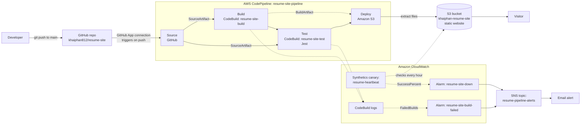

# Resume Website – CI/CD Pipeline on AWS

COMP 4964 DevOps Engineering – Assignment 4
Author: Khai Phan

This repository contains my resume website and the files used by an AWS CodePipeline that builds, tests and deploys it automatically. Every push to the `main` branch updates the live site.

**Live site:** http://khaiphan-resume-site.s3-website-us-west-2.amazonaws.com

---

## 1. Pipeline architecture



### Stages

| Stage | Service | Input | What it does |
|---|---|---|---|
| Source | GitHub (via GitHub App) | – | Starts the pipeline on every push to `main` and packages the repo as `SourceArtifact` |
| Build | CodeBuild `resume-site-build` | SourceArtifact | Runs `buildspec-build.yml`: copies `index.html` and `css/` into `dist/`. Output is `BuildArtifact` |
| Test | CodeBuild `resume-site-test` | SourceArtifact | Runs `buildspec-test.yml`: `npm ci` then `npm test` (8 Jest tests). If any test fails, the pipeline stops and nothing is deployed |
| Deploy | Amazon S3 | BuildArtifact | Extracts the files into the root of bucket `khaiphan-resume-site` with `Cache-Control: no-cache`. Rolls back automatically if it fails |

### Why two artifacts

- **SourceArtifact** is the full repo. The Test stage needs it because Jest needs `package.json` and the `tests/` folder.
- **BuildArtifact** only holds the website files from `dist/`. Only this is deployed, so test and config files never reach the public bucket.
- The stage order Build → Test → Deploy means a failing test blocks the deploy. The live site keeps the last good version.

### Monitoring and logging

| Resource | Watches | Fires when |
|---|---|---|
| CloudWatch Logs `/aws/codebuild/resume-site-build` and `/aws/codebuild/resume-site-test` | Full output of every build and test run | – (used for troubleshooting) |
| Alarm `resume-site-build-failed` | Pipeline health: `AWS/CodeBuild` `FailedBuilds` (Sum, 5 min) | 1 or more failed builds |
| Synthetics canary `resume-heartbeat` | Website health: loads the live site every hour and takes a screenshot | – |
| Alarm `resume-site-down` | `CloudWatchSynthetics` `SuccessPercent` (Average, 1 hour) | Below 100% |

Both alarms send an email through SNS topic `resume-pipeline-alerts`.

---

## 2. Repository layout

```
resume-site/
├── index.html            Resume page
├── css/style.css         Styles (light and dark mode, mobile layout)
├── tests/resume.test.js  Jest tests (run in the Test stage)
├── buildspec-build.yml   Build stage instructions
├── buildspec-test.yml    Test stage instructions
├── package.json          Jest and jsdom as dev dependencies
├── package-lock.json     Locked versions, required by npm ci
├── .gitignore            Excludes node_modules, dist, logs, OS files, .env
└── README.md             This document
```

### Automated tests

`tests/resume.test.js` loads `index.html` in jsdom (a simulated browser) and checks that:

1. The page title includes the name
2. The `<h1>` shows the name
3. All five sections exist (education, skills, projects, experience, leadership)
4. No section is empty
5. Contact links are valid (`mailto:` for email, `https://` for the rest)
6. Links that open a new tab use `rel="noopener"`
7. The stylesheet the page links to exists
8. No phone number is published on the public page

Run locally:

```bash
npm install
npm test
```

---

## 3. Setup steps

All resources are in **us-west-2 (Oregon)**.

### 3.1 GitHub repository
1. Create a public repo `resume-site` on GitHub.
2. Push the files in this repo to the `main` branch.

### 3.2 S3 bucket
1. Create bucket `khaiphan-resume-site` (General purpose, ACLs disabled).
2. Turn off **Block all public access**.
3. **Properties → Static website hosting**: Enable, index document `index.html`.
4. **Permissions → Bucket policy**:

```json
{
  "Version": "2012-10-17",
  "Statement": [
    {
      "Sid": "PublicReadGetObject",
      "Effect": "Allow",
      "Principal": "*",
      "Action": "s3:GetObject",
      "Resource": "arn:aws:s3:::khaiphan-resume-site/*"
    }
  ]
}
```

### 3.3 CodeBuild projects
Create two projects in **CodeBuild → Create project**:

| Setting | resume-site-build | resume-site-test |
|---|---|---|
| Source | GitHub, `khaiphan812/resume-site`, no webhook | Same |
| Environment | Managed image, EC2, Amazon Linux, Standard, latest image | Same |
| Service role | New service role | New service role |
| Buildspec name | `buildspec-build.yml` | `buildspec-test.yml` |
| Artifacts | No artifacts | No artifacts |
| Logs | CloudWatch Logs on | CloudWatch Logs on |

The GitHub source is only needed to create the project. When CodePipeline runs the project, the pipeline artifact replaces it.

### 3.4 CodePipeline
**CodePipeline → Create pipeline → Build custom pipeline**:

1. Name `resume-site-pipeline`, new service role.
2. **Source:** GitHub (via GitHub App), repo `khaiphan812/resume-site`, branch `main`, trigger on push.
3. **Build:** AWS CodeBuild, project `resume-site-build`, input `SourceArtifact`.
4. **Test:** AWS CodeBuild, project `resume-site-test`, input `SourceArtifact`.
5. **Deploy:** Amazon S3, bucket `khaiphan-resume-site`, input `BuildArtifact`, **Extract file before deploy** on, deployment path empty, cache control `no-cache`, automatic rollback on stage failure on.

### 3.5 Monitoring
1. **SNS:** create Standard topic `resume-pipeline-alerts`, add an Email subscription and confirm it from the inbox.
2. **Alarm** `resume-site-build-failed`: metric `AWS/CodeBuild FailedBuilds` (Account Metrics), Sum, 5 minutes, `>= 1`, missing data treated as good, notify `resume-pipeline-alerts`.
3. **Canary** `resume-heartbeat`: CloudWatch Synthetics, Heartbeat monitoring blueprint, URL of the live site, screenshots on, runs every 1 hour, new IAM role.
4. **Alarm** `resume-site-down`: metric `CloudWatchSynthetics SuccessPercent` for `resume-heartbeat`, Average, 1 hour, `< 100`, missing data treated as good, notify `resume-pipeline-alerts`.

---

## 4. How to maintain it

### Update the website
1. Edit `index.html` or `css/style.css` and **save the file**.
2. Run `git status` and check the file shows as `modified`.
3. Commit and push:
   ```bash
   git add .
   git commit -m "Describe the change"
   git push
   ```
4. The pipeline starts by itself. After about 3 minutes, refresh the live site.

### Add or change a test
Edit `tests/resume.test.js`, run `npm test` locally, then push. When a new section is added to the page, add its `id` to the section test.

### Check what happened in a run
- **CodePipeline → resume-site-pipeline → Executions** shows every run and the commit that started it.
- For the Build or Test stage, open **AWS CodeBuild** from the stage to see the full log.

### Roll back
- The Deploy stage rolls back automatically if it fails.
- To go back to an older version on purpose, run `git revert <commit>` and push. The pipeline deploys the reverted code.

---

## 5. Troubleshooting

These are the problems found while building this pipeline and how each was fixed.

| Symptom | Cause | Fix |
|---|---|---|
| Site shows `404 NoSuchKey` | Bucket is empty because the pipeline has not deployed yet | Run the pipeline. This error also confirms that hosting and the bucket policy work |
| Site shows `403 Forbidden` | Bucket policy missing, or wrong bucket name in `Resource` | Fix the policy. If saving fails, turn off Block Public Access at the account level |
| Build or Test: `Project cannot be found` | The CodeBuild project was never created (the popup in the pipeline wizard was closed before **Continue to CodePipeline**) | Create the project in the CodeBuild console with the same name, then **Release change** |
| Test: `YAML_FILE_ERROR … buildspec-test.yml: no such file or directory` | Test action input was `BuildArtifact`, which only holds `dist/` | Edit pipeline → Test action → input `SourceArtifact` → Save → Release change |
| `YAML_FILE_ERROR … buildspec.yml` not found | Buildspec name left empty in the project | Edit the project and set the buildspec file name |
| `git commit` says `nothing to commit` | The file was not saved in the editor | Save the file, check `git status`, then commit again |
| Pipeline did not start after a push | No new commit was pushed, or the GitHub connection is not available | Check the commit is on GitHub. Check **Developer Tools → Settings → Connections** shows *Available* |
| Site still shows the old version | Deploy stage has not finished, or browser cache | Wait until all four stages are green, then hard refresh (Cmd + Shift + R) |
| `npm ci` fails in Test | `package-lock.json` missing or out of sync with `package.json` | Run `npm install` locally and commit `package-lock.json` |
| Alarm stays `Insufficient data` | No data point yet | Normal right after creation. It turns `OK` after the next build or canary run |
| No alarm email arrives | SNS subscription not confirmed | Confirm it from the email (check spam). Status must be *Confirmed* |
